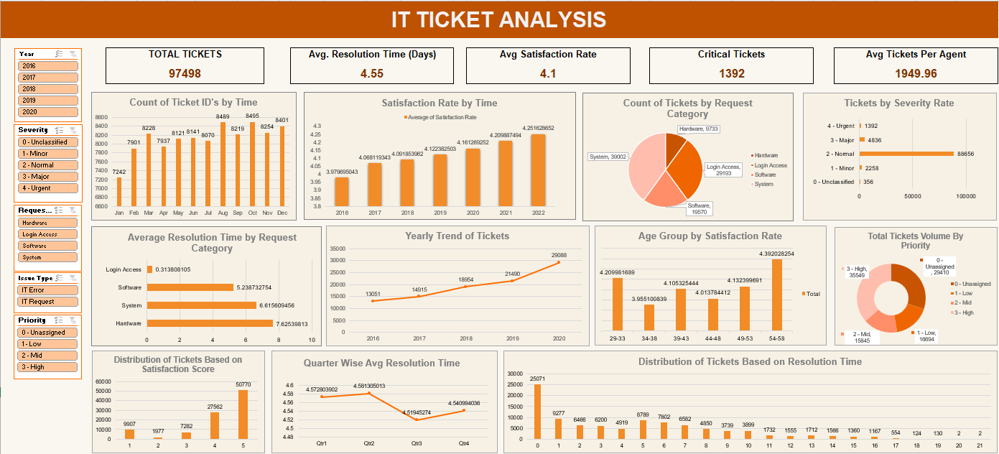

# 🎫 IT Ticket Analysis — Service Desk Performance & Capacity Study

An end-to-end **Excel analytics project** (pivot tables, formulas, and a full interactive dashboard) analysing 5 years of IT service-desk ticket data — built to evaluate agent performance, resolution efficiency, and employee satisfaction, and to turn that into concrete staffing/tooling recommendations.


**Prepared by:** Rupesh Kumar

---

## 📌 Project Overview

**97,498 tickets · 50 IT agents · 2016 – 2020**

This project analyses a five-year IT support ticket log to answer a single core question: *is the service desk keeping up with demand, and if there's budget to invest, where should it go — more agents, better training, or better tooling?*

The work is split into two layers:
- **12 objective questions** — direct, data-driven facts (volumes, distributions, correlations).
- **10 subjective questions** — business questions that require interpreting those facts into a recommendation (training needs, tooling ROI, staffing decisions, forecasts).

Every answer in this repo is backed by a formula, pivot table, or chart in the workbook — nothing is estimated.

---

## 🖼️ Dashboard Preview



*Live, slicer-driven dashboard — filter by Year, Severity, Request Category, Issue Type, or Priority and every KPI tile and chart updates together. Open `data/Rupesh_Kumar_IT_Ticket_Analysis.xlsx` → `Dashboard` sheet to interact with it.*

---

## 🎯 Business Context

**The challenge:** Analyze IT support ticket data to evaluate agent performance, ticket resolution efficiency, and employee satisfaction — and identify performance gaps, operational bottlenecks, and high-impact improvement areas.

**This analysis answers:**
- Where does ticket volume concentrate, and is it growing sustainably?
- Which issue categories take longest to resolve, and why?
- Are tickets being triaged and prioritized effectively at intake?
- Is employee/agent satisfaction improving or declining over time?
- Where should the next investment dollar go — headcount, training, or tooling?

**Business value:** a single, reliable view that turns raw ticket data into staffing, process, and training decisions.

---

## 🗂️ Repository Structure

```
IT-Ticket-Analysis/
│
├── data/
│   └── Rupesh_Kumar_IT_Ticket_Analysis.xlsx   # Full workbook: raw data, cleaned data, 22 pivot/analysis sheets, dashboard
│
├── presentation/
│   └── RupeshKumar_IT_Ticket_Analysis.pptx    # 16-slide stakeholder deck (findings + action plan)
│
├── docs/
│   ├── analysis-report.md                     # Full Q&A write-up: every question, approach, answer, insight, recommendation
│   ├── data-dictionary.md                     # Column-by-column explanation of all three datasets
│   └── RupeshKumar_IT_Ticket_Analysis.docx     # Original submission-format report (source for analysis-report.md)
│
├── images/
│   └── dashboard-preview.png                  # Dashboard screenshot
│
├── README.md                                  # 
```

---

## 📊 Dataset

| | |
|---|---|
| **Source file** | `Rupesh_Kumar_IT_Ticket_Analysis.xlsx` |
| **Core tables** | `Tickets` (raw, 97,498 rows × 10 cols), `IT Agents` (50 rows × 8 cols), `Cleaned Data` (97,498 rows × 21 cols) |
| **Time period** | 2016 – 2020 |
| **Analysis sheets** | 22 pivot/question sheets (`Q-1` – `Q-12` Objective, `Q-1` – `Q-10` Subjective) + `Dashboard` |

Full column-level documentation for all three tables is in **[`docs/data-dictionary.md`](docs/data-dictionary.md)**. In short: `Tickets` is the raw export (ticket ID, date, employee/agent IDs, category, issue type, severity, priority, resolution time, satisfaction); `IT Agents` is the agent reference table (name, email, birth date → derived age); `Cleaned Data` joins the two and adds derived fields (Year, Quarter, Month-Year, Day of Week, Age Band, Severity Rank, parsed email fields) that power every pivot table and chart in the workbook.

### ⚠️ Data cleaning performed
No blank/null cells existed in the raw sheets, but **4 columns had inconsistent category labels or malformed names**, affecting 34,606 ticket rows and 15 agent records — standardized directly in `Cleaned Data` and `IT Agents` (see `docs/analysis-report.md`, Question 2, for the full before/after).

---

## 🧮 Key Findings (Objective)

| # | Question | Answer |
|---|---|---|
| 1 | Total attributes in the data | 16 (10 Tickets + 6 IT Agents) |
| 3 | Average daily ticket volume | **53.37 tickets/day** (97,498 tickets over 1,827 days) |
| 4 | Ticket category distribution | System 40.0% · Login Access 29.9% · Software 20.1% · Hardware 10.0% |
| 5 | Tickets handled per agent | 1,856 – 2,027 per agent (avg. **1,950**) — very evenly distributed |
| 8 | Issue type split | IT Request 75.1% · IT Error 24.9% |
| 9 | Average resolution time | **4.55 days** overall — but 0.31 days (Login Access) vs. 7.63 days (Hardware) |
| 10 | Ticket volume trend | **+122.9%** growth, 13,051 (2016) → 29,088 (2020), accelerating in 2019–20 |
| 11 | Average agent age | 35.4 years, concentrated in the 29–43 range |
| 12 | Severity vs. resolution time correlation | **r = –0.04** — essentially no relationship; severity tagging isn't driving triage |

*(Full detail, formulas, and every question's chart reference: [`docs/analysis-report.md`](docs/analysis-report.md))*

---

## 💡 Key Findings (Subjective / Strategic)

- **Demand is outgrowing the fixed team.** Ticket volume grew **123%** (2016–2020) against a flat 50-agent headcount, with the growth rate *accelerating* (+35% in the final year alone).
- **Satisfaction is not resolution-time-driven.** Satisfaction is nearly identical (4.09–4.11) across categories despite resolution time ranging from 0.31 to 7.63 days — so training should target communication/service quality, not just speed.
- **Triage data is unreliable.** 30% of tickets have no priority assigned and 91% share a single "Normal" severity tag — true urgency isn't visible in the queue today.
- **No agents warrant termination.** The 5 lowest-satisfaction agents all carry a normal ticket load (1,906–2,021 tickets vs. 1,950 team average) — they're coachable, not underutilized or overloaded.
- **Satisfaction is already improving on its own** (3.98 → 4.16, 2016–2020; projected ~4.25 by 2022) — but resolution time is projected to stay **flat** without new investment, so tooling spend should target resolution time specifically, not general satisfaction.
- **Age-band gap:** the 34–38 agent age band has both the longest resolution time (4.68 days) and lowest satisfaction (3.96) of any band — likely a workload concentration issue, not a skills gap.
- **No day-of-week peak exists** — ticket volume is flat within 2.2% across all seven days, so staffing should be level-loaded across the week, not weighted toward particular days.

*(Full detail, approach, and recommendations per question: [`docs/analysis-report.md`](docs/analysis-report.md))*

---

## ✅ Strategic Recommendations

| # | Area | Action |
|---|---|---|
| 1 | Workload Optimization | Build a capacity plan sized to the *accelerating* +35% growth rate, not the 5-year average |
| 2 | Operational Efficiency | Prioritize root-cause/self-service tooling for **System** tickets first (40% of volume) |
| 3 | SLA / Resolution Improvement | Target **Hardware** (7.63-day avg.) with pre-stocked parts and standardized runbooks |
| 4 | Ticket Management | Make Priority a mandatory field at intake — closes the 30% Unassigned gap |
| 5 | Agent Performance | Pair 34–38 age-band agents with 54–58 band mentors to close the satisfaction gap |
| 6 | Management Monitoring | Formally document what drove the 2016–2020 satisfaction gains to keep replicating them |
| 7 | Process Improvement | Eliminate the 356 "Unclassified" severity tickets by enforcing severity at ticket creation |

**Prioritization:** Items 1–3 offer the greatest business impact and should be sequenced first; items 4–7 sustain and protect those gains.

---

## 🛠️ Tools & Techniques Used

- **Microsoft Excel** — PivotTables, PivotCharts, and a slicer-driven interactive dashboard
- **Formulas** — `INDEX/MATCH`, `GETPIVOTDATA`, `AVERAGEIFS`, `CORREL`, `FORECAST.LINEAR`, `SWITCH`, text-extraction formulas for email domains
- **Data cleaning** — label standardization, naming-convention cross-checks (`Cleaned Data` sheet)
- **PowerPoint** — stakeholder-ready summary deck with insights, approach, and recommendations per visual
- **Statistical methods** — correlation analysis, linear trend forecasting, segment/cohort comparison

---

## 🚀 How to Use This Project

1. **Clone the repo**
   ```bash
   git clone https://github.com/<your-username>/IT-Ticket-Analysis.git
   cd IT-Ticket-Analysis
   ```
2. **Open the workbook** — `data/Rupesh_Kumar_IT_Ticket_Analysis.xlsx` in Excel. Start with the `Dashboard` sheet, then explore any `Q-#` sheet for the pivot table/chart behind a specific answer.
3. **Read the full write-up** — [`docs/analysis-report.md`](docs/analysis-report.md) has every question, approach, formula, insight, and recommendation in one place.
4. **Browse the deck** — `presentation/RupeshKumar_IT_Ticket_Analysis.pptx` for the condensed, stakeholder-facing version.

---

## 👤 Author

**Rupesh Kumar**
📧 rupeshkumar230299@gmail.com · 🔗 [LinkedIn](www.linkedin.com/in/rupesh-kumar-0056351ba) · 🐙 [GitHub](https://github.com/Rupesh023)

---
